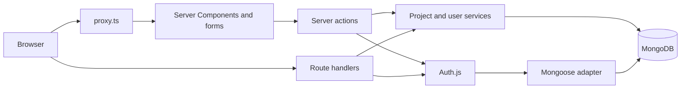

# Harbor

[](https://github.com/faheemdev78/nextjs-mongodb-saas-starter/actions/workflows/ci.yml)
[](https://nextjs.org)
[](https://www.typescriptlang.org/)
[](https://www.mongodb.com/)
[](LICENSE)

Harbor is a Next.js App Router SaaS starter for a signed-in workspace. It ships with Auth.js (email and password, plus optional GitHub), role-based access, and a projects resource that supports search and pagination. Forms use server actions. The same rules are exposed as JSON route handlers.

The sample product is intentionally small: two roles, one resource, and the wiring you would keep when you replace projects with your own model.

## Features

- Next.js 16 App Router, React 19, and TypeScript
- Auth.js credentials provider and optional GitHub provider
- JWT sessions, with a Mongoose adapter for users and OAuth accounts
- Roles: `admin` and `user`
- Protected dashboard and an admin-only team page
- Projects CRUD through server actions and `/api/projects`
- Zod validation shared by forms and route handlers
- Search, status filter, and pagination
- Tailwind CSS v4 and shadcn/ui, with light, dark, and system themes
- Idempotent seed script with demo accounts
- Docker Compose for MongoDB and the app
- ESLint, Prettier, Vitest, Playwright, and GitHub Actions

## Architecture



**Proxy.** `src/proxy.ts` is the Next.js 16 rename of Middleware. It only decodes the JWT. Anonymous requests to `/dashboard` go to `/login`. A signed-in non-admin who opens `/dashboard/admin` is sent back to the overview. The proxy is an optimistic check. Every action, page, and route handler checks the session again.

**Sessions.** Credentials authentication requires JWT sessions, so the cookie is the session. The role is written into the token at sign-in. Changing a role on the team page takes effect the next time that person signs in.

**Data.** Mongoose models live in `src/models`. `src/lib/projects.ts` is the only place that applies ownership rules: a user sees and edits their own projects, and an admin sees and edits all of them. Server actions and route handlers both call that module, then Zod parses the input before it gets there.

**OAuth.** GitHub sign-in is hidden until `AUTH_GITHUB_ID` and `AUTH_GITHUB_SECRET` are set. The Mongoose adapter stores the Auth.js user and the linked GitHub account in the same database as credential users. An email that already has a password is not automatically linked to GitHub.

**Cache Components.** The App Router template enables Cache Components. Dashboard routes opt out of instant navigation with `instant = false` and read the session inside `<Suspense>`, because a session cannot be part of the static shell.

## Quick start

Requirements: Node.js 22+, npm, and MongoDB 7 or 8. Docker is the shortest way to get the database.

```bash
cp .env.example .env.local
openssl rand -base64 32   # paste the result into AUTH_SECRET
docker compose up -d mongo
npm install
npm run seed
npm run dev
```

Open [http://localhost:3000](http://localhost:3000).

`docker compose up --build` also starts the Next.js app on port 3000. Seed from the host after MongoDB is healthy. The published database port is `27017`.

```bash
docker compose up -d mongo
npm run seed
docker compose up --build app
```

The Compose file includes a local-only `AUTH_SECRET` default so the stack boots. Override it in `.env.local` or the shell before you share the machine. Do not deploy that default.

### Demo accounts

`npm run seed` is idempotent. It resets these two users and their sample projects. The script refuses to run when `NODE_ENV=production` unless `SEED_DEMO_DATA=true`.

| Role  | Email             | Password     |
| ----- | ----------------- | ------------ |
| admin | admin@example.com | Password123! |
| user  | user@example.com  | Password123! |

These passwords are fixtures committed in `src/lib/constants.ts`. They are not production secrets. The user owns nine projects, so their list paginates. The admin sees all twelve.

## Scripts

| Script                 | What it does                                  |
| ---------------------- | --------------------------------------------- |
| `npm run dev`          | Next.js dev server                            |
| `npm run build`        | Production build                              |
| `npm run start`        | Serve the production build                    |
| `npm run lint`         | ESLint                                        |
| `npm run format`       | Prettier write                                |
| `npm run format:check` | Prettier check                                |
| `npm run typecheck`    | `next typegen` and `tsc --noEmit`             |
| `npm test`             | Vitest unit tests                             |
| `npm run test:e2e`     | Playwright smoke test against `npm run start` |
| `npm run seed`         | Load demo users and projects                  |

## Project layout

```text
src/app/(marketing)          public landing page
src/app/(auth)               login and registration
src/app/dashboard            overview, projects, admin team
src/app/api/auth             Auth.js route
src/app/api/projects         JSON CRUD
src/actions                  server actions
src/lib/auth.ts              Auth.js config, credentials, adapter
src/lib/projects.ts          ownership rules and queries
src/models                   Mongoose schemas
src/proxy.ts                 optimistic route protection
scripts/seed.ts              demo data
tests/unit                   validators, RBAC, pagination
tests/e2e                    Playwright smoke test
```

## API

All project routes require a session cookie. A missing session is `401`. A project that exists but belongs to someone else is `403`. An unknown id is `404`.

| Method   | Path                | Body                            |
| -------- | ------------------- | ------------------------------- |
| `GET`    | `/api/projects`     | Query: `q`, `status`, `page`    |
| `POST`   | `/api/projects`     | `{ name, description, status }` |
| `GET`    | `/api/projects/:id` |                                 |
| `PATCH`  | `/api/projects/:id` | Any subset of the create body   |
| `DELETE` | `/api/projects/:id` |                                 |

`status` is `planned`, `active`, or `completed`.

## Tests and CI

Unit tests do not need MongoDB. They cover Zod schemas, role checks, and the pagination helpers.

The Playwright smoke test loads the home, login, and register pages, confirms `/dashboard` redirects when signed out, and calls `/api/health`. Run a production build first:

```bash
npm run build
npm run test:e2e
```

GitHub Actions runs lint, Prettier, the typecheck, Vitest, the production build, and the smoke test on every push to `main` and every pull request.

## GitHub OAuth

1. Create an OAuth app at [github.com/settings/developers](https://github.com/settings/developers).
2. Set the callback URL to `http://localhost:3000/api/auth/callback/github`.
3. Put the client id and secret in `.env.local`.
4. Restart the dev server.

The button appears only when both variables are set. GitHub users receive the `user` role.

## Deployment notes

- Set `AUTH_SECRET`, `AUTH_URL`, `MONGODB_URI`, and `MONGODB_DB` in the host environment.
- `AUTH_URL` must be the public origin, including `https://` in production.
- Put the app behind TLS. Auth.js marks the session cookie secure when the site is HTTPS.
- Do not run the demo seed against a production database unless you mean to.
- The Docker image runs `next start`. Pass the real environment at runtime. The Compose `AUTH_SECRET` default is for local use only.

## License

[MIT](LICENSE)
